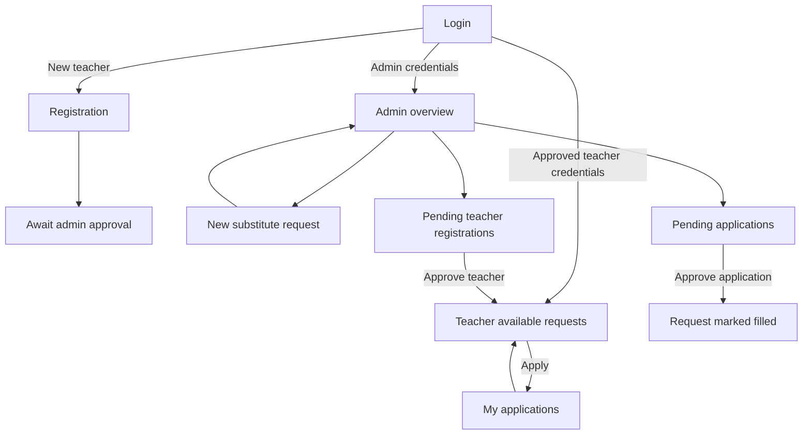

# EduSub — Milestone 1 low-fidelity UI wireframes

**Status:** Proposed design sketches created 27 October 2026; **not implemented or usability-tested**. These sketches are deliberately simple text diagrams so the whole team can review and edit them via Git. Screen examples contain fictional data. Product and workflow grounding: [README](../README.md), [Milestone 1–2 record](MILESTONE-1-2.md).

## Navigation and roles



Role-dependent access is enforced by the API, not by hiding UI links alone. A registered but unapproved teacher cannot log in (403). First milestone UI concepts below aim for four core views; registration/approval are annotated as secondary supporting screens.

## Sketch A — Login (both roles)

```text
┌──────────────────────────────────────────────┐
│ EduSub                              [Hilfe]  │
│                                              │
│           Stellvertretungen koordinieren    │
│                                              │
│           E-Mail-Adresse                    │
│           [admin@example.invalid________]   │
│                                              │
│           Passwort                          │
│           [••••••••••••••••_____________] 👁 │
│                                              │
│           [          Anmelden          ]     │
│           Als Lehrperson registrieren       │
│                                              │
│           Fehler: E-Mail oder Passwort      │
│           stimmt nicht.                     │
└──────────────────────────────────────────────┘
```

**Actions:** Submit credentials → `POST /api/v1/auth/login` with OAuth2 form `username=<email>`, `password=<password>`. Navigate by role after token issued. **Feedback:** Loading indicator, field-level required messages, generic 401 invalid-login error, 403 pending approval message. Do not display or log tokens. Consider password reset as a future feature; no reset endpoint is claimed.

## Sketch B — Admin overview + new substitute request

```text
┌──────────────────────────────────────────────────────────────────────┐
│ EduSub / Administration           [Anfragen] [Lehrpersonen] [Logout] │
├──────────────────────────────────────────────────────────────────────┤
│ Übersicht                                                            │
│ [Offen: 3]        [Besetzt: 8]      [Bewerbungen: 2] [Freigaben: 1]  │
│                                                                      │
│ Stellvertretungsanfragen                      [+ Neue Anfrage]       │
│ ┌──────┬────────┬───────────┬─────────┬──────────┬────────────────┐  │
│ │ ID   │ Datum  │ Klasse    │ Fach    │ Status   │ Aktionen       │  │
│ ├──────┼────────┼───────────┼─────────┼──────────┼────────────────┤  │
│ │ 23   │ 01.12. │ 3a        │ Mathe   │ Offen    │ Ansehen Ändern │  │
│ │ 22   │ 26.11. │ 4b        │ Deutsch │ Besetzt  │ Ansehen        │  │
│ └──────┴────────┴───────────┴─────────┴──────────┴────────────────┘  │
└──────────────────────────────────────────────────────────────────────┘

    [+ Neue Anfrage] opens form:

    ┌──────────────────────────────────────────┐
    │ Neue Stellvertretungsanfrage         [×] │
    │ Datum*        [2026-12-01______]         │
    │ Klasse*       [3a              ▾]       │
    │ Fach*         [Mathematics     ▾]       │
    │ Zeitfenster   [08:00-10:00_____]         │
    │ Notiz         [_______________]         │
    │               [_______________]         │
    │                                          │
    │ [Abbrechen]          [Anfrage erstellen] │
    │                                          │
    │ Fehlerbereich bei ungültigen Angaben    │
    └──────────────────────────────────────────┘
```

**Actions/data:** `GET /api/v1/dashboard/admin`, `GET /api/v1/requests/`, `GET /api/v1/subjects/`, `POST /api/v1/requests/` (JSON uses `date`, `grade_level`, `subject_id`, `time_slot`, `note`). Successful POST (201) returns to table with prominent success feedback. **Errors:** Date in past, unsupported grade, negative subject ID or inverted time range → 422; unknown subject ID → 400; expired session → 401; insufficient role → 403. Form prevents duplicate click during saving. Edit only open requests; errors for status conflict (409). Table values here are illustrative, not database snapshots.

## Sketch C — Teacher: available requests and application

```text
┌──────────────────────────────────────────────────────────────────────┐
│ EduSub / Lehrperson              [Verfügbar] [Meine Bewerbungen]     │
├──────────────────────────────────────────────────────────────────────┤
│ Offene Stellvertretungen                      [Mein Profil] [Logout] │
│ Klasse [Alle ▾]   Fach [Alle ▾]           [Filter zurücksetzen]      │
│                                                                      │
│ ┌────────────────────────────────────────────────────────────────┐   │
│ │ 3a  ·  Mathematik                 01.12.2026 · 08:00–10:00      │   │
│ │ Vertretung für zwei Lektionen                              │   │
│ │ [Details anzeigen]                           [Bewerben]        │   │
│ └────────────────────────────────────────────────────────────────┘   │
│ ┌────────────────────────────────────────────────────────────────┐   │
│ │ 4b  ·  Deutsch                    03.12.2026 · 09:00–11:00      │   │
│ │ [Details anzeigen]                           [Bewerben]        │   │
│ └────────────────────────────────────────────────────────────────┘   │
│ Keine Treffer? «Keine passenden offenen Anfragen vorhanden.»        │
└──────────────────────────────────────────────────────────────────────┘
```

**Actions/data:** Approved teacher signs in; `GET /api/v1/requests/open` lists active unexpired items; `POST /api/v1/requests/{request_id}/apply` returns 201 and a pending application. Change primary button to “Beworben” after success. **Errors:** 401/403 auth; application already exists (business-rule rejection), request no longer open (conflict); show actionable, accessible inline feedback, preserve list position. Subject filtering is a **design proposal**: the currently implemented open-request endpoint supports `grade_level`, not a subject query parameter. The UI could filter an already fetched list or the backend can be extended.

## Sketch D — Admin reviews applicants / approves assignment

```text
┌──────────────────────────────────────────────────────────────────────┐
│ EduSub / Administration                         [Zurück zur Liste]    │
├──────────────────────────────────────────────────────────────────────┤
│ Stellvertretung #23                 Status: OFFEN                   │
│ Datum: 01.12.2026      Klasse: 3a       Fach: Mathematik           │
│ Zeit: 08:00–10:00      Notiz: Vertretung für zwei Lektionen         │
│                                                                      │
│ Bewerbungen                                                         │
│ ┌────────────────────────────────────────────────────────────────┐   │
│ │ Test Lehrperson             Status: ausstehend                │   │
│ │ [Profil ansehen]   [Ablehnen]          [Bewerbung genehmigen] │   │
│ └────────────────────────────────────────────────────────────────┘   │
│                                                                      │
│ Bestätigungsdialog: «Lehrperson verbindlich zuweisen?»              │
│ [Abbrechen] [Ja, genehmigen]                                         │
│                                                                      │
│ Nach Erfolg: Anfrage BESetzt · Bewerbung genehmigt                 │
│ Andere ausstehende Bewerbungen: automatisch abgelehnt              │
└──────────────────────────────────────────────────────────────────────┘
```

**Actions/data:** `GET /api/v1/applications/pending` (admin), `GET /api/v1/teachers/{teacher_id}`, `PATCH /api/v1/applications/{application_id}/approve`. Successful approve updates application status to `approved` and request status to `filled`; other pending applicants are rejected by business service. **Error:** conflicting second approval (409), stale data refreshed; no misleading success state before HTTP 200. The full per-request applicants view may require client-side filtering of the global pending list or an API extension, because a `GET /requests/{id}/applications` route is **not** part of the currently implemented backend.

## Mobile wireframe pattern (proposed 375px)

```text
┌──────────────────────────────┐
│ EduSub            [Menü ☰]   │
├──────────────────────────────┤
│ Offene Anfragen              │
│ Klasse  [Alle ▾]             │
│                              │
│ ┌──────────────────────────┐ │
│ │ 3a · Mathematik          │ │
│ │ 01.12. · 08:00–10:00     │ │
│ │ [Details]  [Bewerben]    │ │
│ └──────────────────────────┘ │
│ ┌──────────────────────────┐ │
│ │ 4b · Deutsch             │ │
│ │ 03.12. · 09:00–11:00     │ │
│ │ [Details]  [Bewerben]    │ │
│ └──────────────────────────┘ │
│                              │
│ [Verfügbar] [Bewerbungen]    │
└──────────────────────────────┘
```

**Responsive intent:** Desktop table becomes stacked cards; form becomes full-width with scroll; major actions have clear text and usable touch targets. Keyboard focus, visible labels, meaningful error messages, and color-independent status text are design requirements to validate during implementation.

## State and error examples for coaching discussion

| Event | UI response | Backend status / contract |
| --- | --- | --- |
| Invalid login | Generic credentials error | 401 |
| Teacher registration successful | “Warten auf Freigabe” screen | 201 registration, `is_approved: false` |
| Teacher logs in before approval | Account pending approval notice | 403 |
| Admin creates request | Success alert and new table row | 201 |
| Admin submits invalid time/date/grade | Field help; retain entered form data | 422 |
| Teacher applies | Card action changes to “Beworben” | 201 |
| Admin approves application | `filled` request and `approved` application | 200 |
| Second approval on filled request | Conflict message, refresh list | 409 |
| Network error | Non-destructive retry action | Client/network condition, not guaranteed API status |

## Open decisions — team and lecturer to confirm

1. Review these low-fidelity sketches with the **actual team**, record feedback/date and replace provisional layouts as needed.
2. Are category filters sufficient, or should the backend expose richer filtering/search?
3. Does request expiry delete or archive records? Archiving better serves audit-trail goals.
4. Is “withdraw application” included in scope? The older README sketches that feature, but it must not be claimed as tested without matching routes.
5. Which additional screens are essential to the **Milestone 3 integrated UI journey**: registration, admin teacher approval, request list, form and application approval?
6. Validate the navigation and error flows against real user needs. **No usability study or coaching approval has been carried out by this document.**

**Traceability:** Screens B–D correspond to W-02/W-03/W-04 in the README; registration/approval links to W-01. These are text-based sketches that fulfill an early design-artifact purpose, **not functional UI files**.
